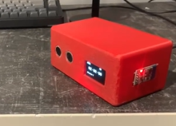

# Bluetooth Alarm Clock

A standalone alarm clock that fixes a problem with phone alarms: with the phone next to the bed, it is too easy to dismiss the alarm without properly waking up. This clock sits elsewhere in the room, and its alarms are set from an iPhone app over Bluetooth. When an alarm goes off, the only way to stop it is to physically reach the clock, which gets you out of bed.

**Demo video:** [Watch the demo](docs/alarmDemo.mp4)

**App video:** [Watch the demo](docs/appDemo.mp4)



---

## How it works

1. **Set alarms.** In the iPhone app, connect to the clock over Bluetooth and add up to five alarms with a time picker. You can also choose one of three alarm melodies.
2. **Store.** The app sends each alarm to the clock, and the Arduino stores it in memory.
3. **Keep time.** A DS3231 real-time clock (RTC) keeps accurate time on its own, so the clock works without the phone being connected.
4. **Ring.** When an alarm time is reached, the buzzer plays the selected melody on a loop. Alarms repeat every day until they are cleared.
5. **Stop.** An ultrasonic sensor measures the distance in front of the clock. The alarm stops when you come within 12 cm of it.

The OLED display shows the time, whether the alarm is ringing, the selected melody, and how many alarms are stored.

## Features

| Feature | Detail |
|---|---|
| iPhone app | Add alarms, swipe to delete one, choose a melody, clear all alarms |
| Bluetooth | Sends alarm settings from the phone to the clock |
| DS3231 RTC | Keeps accurate time independently of the phone |
| Alarms | Up to 5 stored |
| Melodies | 3 selectable (M1, M2, M3) |
| Ultrasonic sensor | Stops the alarm when you are within 12 cm |
| OLED display | Time, ringing status, melody and alarm count |
| Power | USB, so it runs from a portable battery pack |

## Bluetooth commands

The app sends short text commands, each ending in `#`:

| Command | Meaning |
|---|---|
| `A0730#` | Add an alarm for 07:30 (`A` followed by HHMM) |
| `D0730#` | Delete the alarm at 07:30 (sent when you swipe an alarm away in the app) |
| `DA#` | Delete all alarms. The clock replies `CLEARED#` |
| `M1#`, `M2#`, `M3#` | Select melody 1, 2 or 3 |

## Hardware

- Arduino [add board model]
- DS3231 real-time clock
- SH1106 OLED display, 128 × 64, I2C (address 0x3C)
- Bluetooth Low Energy module (AT-09 type, shown in the app as "ELEGOO BT16") [confirm]
- Ultrasonic sensor (trigger and echo)
- Buzzer
- 3D-printed enclosure (PLA) from my own CAD design

The wiring schematic is in `docs/schematic.png`.

### Pin map

| Component | Pin |
|---|---|
| Buzzer | 9 |
| Ultrasonic TRIG | 6 |
| Ultrasonic ECHO | 7 |
| Bluetooth module | Hardware serial (D0 RX / D1 TX) |
| RTC and OLED | I2C (SDA / SCL) |

## Setting up the Arduino

1. Install these libraries from the Arduino IDE Library Manager: **RTClib** (Adafruit), **Adafruit GFX** and **Adafruit SH110X**.
2. Open `alarm_clock/alarm_clock.ino`.
3. Wire the hardware following the pin map above.
4. Disconnect the Bluetooth module's TX and RX wires while uploading. It shares the hardware serial pins with the USB connection, and reconnect them afterwards.
5. The sketch does not set the RTC time. Set it once using the DS3231 example that comes with RTClib. The RTC then keeps the time on its own.

## Setting up the app

The app is a Flutter project in the `app/` folder, using the `flutter_blue_plus` package for Bluetooth.

1. Install Flutter and Xcode.
2. In `app/`, run `flutter pub get`.
3. Connect an iPhone and run `flutter run`.
4. Open the **Bluetooth** tab, tap **Scan**, and select the clock.
5. Go to the **Alarms** tab. Use **+** to add an alarm, swipe an alarm to the left to delete it, tap **M1**, **M2** or **M3** to pick a melody, and tap **Clear All** to remove every alarm.

The Bluetooth permission text that iOS requires is already set in `app/ios/Runner/Info.plist`.

## Design notes

- **Enclosure.** The CAD design is a compact case that holds the electronics securely while keeping the display, controls, buzzer and ultrasonic sensor accessible. It was split into separate parts to simplify printing, and tolerances were chosen so that it can be opened for maintenance.
- **Sensor position.** I used prototypes to refine the position of the ultrasonic sensor so that it reliably detects the user.
- **Limited processing.** The Arduino has limited processing capacity, so the Bluetooth parsing is deliberately simple: short `#`-terminated commands with no extra checking. The cost is that communication is slightly more susceptible to interference. A more capable microcontroller would allow a more robust protocol.

## Limitations

- Alarms are stored in the Arduino's memory, so they are lost if the clock loses power and need to be sent again from the app.
- The command parser does not check that times are valid. The app's time picker keeps values in range.
- Only five alarms are stored. Further alarms are ignored without any message.
- The 12 cm stopping distance is fixed in the code.
- The app does not detect a dropped connection. Its alarm list is not saved or read back from the clock, so after the app is reopened the list is empty even though the clock still holds its alarms.

## Possible improvements

- Use a more capable microcontroller and a more robust Bluetooth protocol.
- Store alarms in EEPROM so they survive a power loss.
- Read the stored alarms back from the clock so that the app's list always matches it.
- Make the stopping distance adjustable.

## Repository contents

```
alarm_clock/    Arduino firmware (alarm_clock.ino)
app/            Flutter iPhone app
docs/           Photos, schematic, app screenshots
```

## Credits

I wrote the pseudocode and defined the app's functionality, then used the AI assistant in Visual Studio Code to translate it into Dart (Flutter) and implement the app code, as the language and iPhone development setup were new to me. The Arduino firmware, enclosure design and testing are my own work.

Part of my MIT Maker Portfolio. Built by Rodryk Carvalho.
